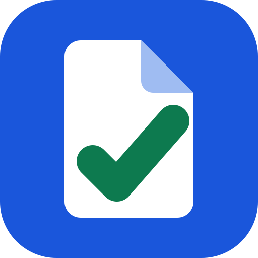

# PageAudit — skill and MCP server for AI agents



PageAudit checks a web page the way a search engine and a careful reviewer would, and returns the fix. One call
reads the title, description, canonical, robots rules, Open Graph, headings, structured data (JSON-LD), security
headers and page delivery, and gives each finding its evidence and a ready change. It can compare a deploy
preview with production and show only what got worse. This repository packages the PageAudit skill and the
connection to its remote MCP server for Claude Code, Codex, Cursor and other agents.

**Site:** https://pageaudit.online · **MCP server:** `https://pageaudit.online/mcp?checkout=site` ·
**Prices:** https://pageaudit.online/pricing · **API docs:** https://pageaudit.online/developers

## What your agent can do

- Audit a URL in one call: score, findings with evidence, and the raw JSON-LD and response headers.
- Get the consolidated patch: the `<head>` block to paste, the files to create and templates to fill in.
- Compare a page with an earlier audit of the same owner, by finding code: what appeared and what disappeared.
- Keep pages in tabs, re-run them, read their history and watch them daily for regressions.
- Run a Lighthouse lab test through Google PageSpeed Insights and read the scores.

Try: *"Audit https://example.com and give me the head tags to fix."* or
*"Compare the preview of this deploy with production and tell me what got worse."*

## GitHub Actions

[wrpbr/pageaudit-action](https://github.com/wrpbr/pageaudit-action) audits each deploy preview against
production and writes what got worse in the job summary. It can fail the job on a regression. Without any YAML,
the [PageAudit GitHub App](https://github.com/apps/pageaudit-seo-check) puts a `PageAudit` check run on the commit
of each preview deployment.

## Install

Claude Code, as a plugin with the skill and the MCP server:

```
/plugin marketplace add wrpbr/pageaudit
/plugin install pageaudit@pageaudit
```

Any agent that reads Agent Skills (Claude Code, Codex, Cursor, OpenCode and others):

```bash
npx skills add wrpbr/pageaudit
```

Only the MCP server (remote, Streamable HTTP, no key needed to start):

```bash
claude mcp add --transport http pageaudit 'https://pageaudit.online/mcp?checkout=site'   # Claude Code
codex mcp add pageaudit --url 'https://pageaudit.online/mcp?checkout=site'               # Codex
```

```json
{ "mcpServers": { "pageaudit": { "url": "https://pageaudit.online/mcp?checkout=site" } } }
```

The JSON above goes in `.cursor/mcp.json` for Cursor and in the MCP settings of most other clients. For the GitHub
Copilot coding agent, add it in the repository settings, under Copilot → MCP servers, with `"type": "http"` and the
tools you allow, for example `audit_url` and `get_patch`.

## Price

Audits have a free daily allowance. The current allowances, the options past them and their prices are at
https://pageaudit.online/pricing. The daily watch needs an account. Nothing renews automatically. The plugin never
pays: with `checkout=site`, the MCP server has no purchase tool and no payment argument.

## What the plugin sends

The skill tells the agent to call the PageAudit API at pageaudit.online. The MCP server also runs at
pageaudit.online. The URLs you audit go to pageaudit.online over HTTPS, and PageAudit fetches those pages. The
plugin runs no local program and reads no local file.

## Em português

O PageAudit confere uma página como um buscador e um revisor atento fariam, e devolve a correção: título,
descrição, canonical, robots, Open Graph, cabeçalhos, JSON-LD, cabeçalhos de segurança e entrega da página, com a
evidência e a mudança pronta para cada problema. Também compara a prévia de um deploy com a produção e mostra só o
que piorou. Instale com os comandos acima. Os preços estão em https://pageaudit.online/pricing.

## Files

| File | What it is |
|---|---|
| `skills/pageaudit/SKILL.md` | The skill: which tool answers which question, and the rules for limits and payment |
| `.mcp.json` | The remote MCP server of the plugin |
| `.claude-plugin/plugin.json` | The plugin manifest |
| `.claude-plugin/marketplace.json` | Lets Claude Code add this repository as a plugin marketplace |
| `server.json` | The manifest in the official MCP registry (`online.pageaudit/pageaudit`) |
| `glama.json` | The maintainer for the Glama MCP directory |

## License and contact

The files in this repository are under the MIT-0 license. The PageAudit service is not part of this license: its
use follows the [terms of use](https://pageaudit.online/terms) and the
[privacy policy](https://pageaudit.online/privacy). For questions or problems, open an issue here or write to
contato@pageaudit.online.
